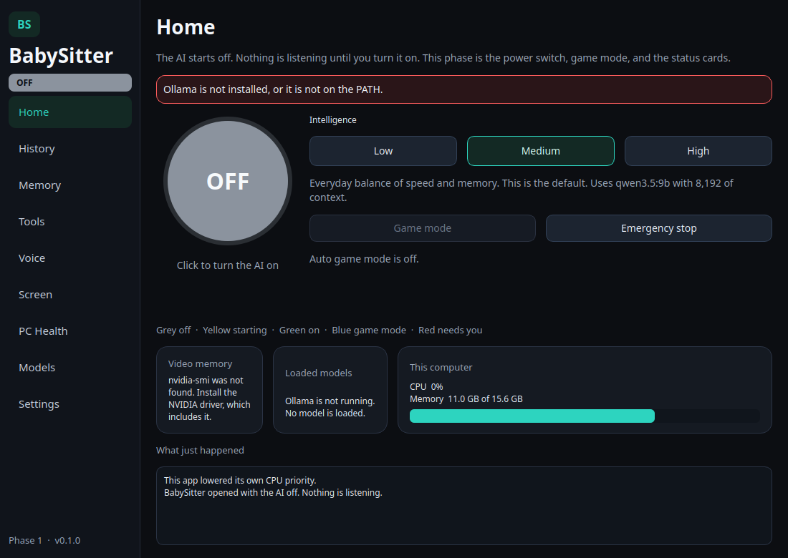

# BabySitter

BabySitter is a voice assistant for your Windows PC. You talk, it talks, and a small frog on the screen shows what it is doing. It is not a chat window. The AI stays off until you turn it on. A reminder still counts down and rings while the AI is off, as long as BabySitter is open.

The window icon is a placeholder: the letters **BS** on a teal circle. Your own artwork can replace it later.

## If you opened this on GitHub

The green **Code** button, and **Download ZIP**, give you the program source: the Python files, the pictures, and `requirements.txt`. That download does **not** include Ollama or the AI models. Tagged releases on GitHub publish `BabySitter.exe` with a `SHA256SUMS.txt` fingerprint so **Update BabySitter** in Settings can verify and install them after you confirm.

On a Windows PC, after you unzip the folder:

1. Install Python 3.12 from [python.org](https://www.python.org/downloads/windows/). On the first screen, check **Add python.exe to PATH**.
2. Install [Ollama](https://ollama.com/download). BabySitter does not download that installer. The file changes, and this project only keeps a download it can check.
3. Double-click **`Setup.bat`**. It makes the Python folder and downloads the libraries named in `requirements.txt`. It then tells you what is still missing.
4. When it asks, type **Y** to download `qwen3.5:9b` and `gemma4:12b`. Each one is several gigabytes. Ollama fetches them. Press Enter to skip.
5. Double-click **`Run BabySitter.bat`**.

The NVIDIA driver is installed from NVIDIA. This setup does not download it. Voice files and the sharper memory stay inside the app. They download later, only after you say yes, and each file is checked.

If you were handed `BabySitter.exe` on its own, you can skip this section. That file does not need Python. It still needs Ollama and the two models on the PC.

## What you need

- Windows 11
- Python 3.12, only if you are running from this folder (the installed `.exe` will not need Python)
- [Ollama](https://ollama.com/download), already installed, serving `http://127.0.0.1:11434`
- An NVIDIA graphics card, and the NVIDIA driver (that driver includes `nvidia-smi`)
- The model `qwen3.5:9b` already downloaded in Ollama

Your PC (Ryzen 9 7900X, RTX 4070 12 GB, 32 GB RAM) is enough. Only one model is loaded at a time.

## Run it from this folder

Do this once:

1. Install Python 3.12 from [python.org](https://www.python.org/downloads/windows/). On the first screen, check **Add python.exe to PATH**.
2. Open this folder in File Explorer.
3. Click the address bar, type `cmd`, and press Enter. A command window opens in this folder. That window is only for setup.
4. Copy these two lines, one at a time:

```bat
py -3.12 -m venv .venv
.venv\Scripts\python -m pip install -r requirements.txt
```

The second line can take a few minutes. It downloads the window toolkit. The versions are pinned, with a checksum on every file, so you get the exact files this project was tested with.

Then, every time you want to open BabySitter:

- Double-click **`Run BabySitter.bat`**.

A command window appears for a moment while it checks that the program can start, then it closes. You should see a dark window titled BabySitter, and a small circle (the orb) near the bottom-right of the screen. **`Run BabySitter.vbs`** does the same thing with no command window.

If the command window stays open, the text in it is the reason. Copy all of it. If nothing appears at all, double-click **`Show errors.bat`**. That window stays open. Copy **all** of the text and send it to me. The same text is also saved as `startup-error.txt` in `%LOCALAPPDATA%\BabySitter\logs\`.



The picture above was taken on a computer that does not have Ollama or an NVIDIA card, so it shows those two warnings. On your PC the red line names your Ollama version (or stays hidden if it is 0.35.0 or newer), and the video-memory card shows the RTX 4070.


## What you should see

- The window opens in **Half screen**, leaving room for a game beside it. Press **Full screen** in the title bar for the whole desk; the choice is remembered.
- The pages sit in a rail on the left, in three groups: Today, Assistant, and This PC.
- The power mark says **Off**. Its color is grey, and the frog orb on the desktop is asleep on its lily pad.
- The words under the power mark say the next click. Nothing is listening.
- Video memory, CPU, and RAM refresh every 2 seconds while the window is open.
- Home shows the next reminder and the time left. The Reminders page shows that countdown on every row.

Colors, on the button and on the orb:

| Color | Meaning |
| --- | --- |
| Grey | Off |
| Yellow | Working (starting or stopping) |
| Green | On. Listening, Thinking, and Speaking stay green and change the motion. |
| Blue | Game |
| Red | Needs you. Read the reason. |

Orange buttons are actions. The other colors are only for those states. From the keyboard, **Ctrl+L** jumps to the command box on Home, **F11** switches between Half screen and Full screen, **Ctrl+PageDown** and **Ctrl+PageUp** move through the pages in the left rail, and **Esc** clears an input box or closes the window to the tray (turning the AI off).

**Choose my picture** sits on the frog-pond picture. That picture fills the assistant panel and is cropped so the frog stays in view. Off turns it grey. The button copies a photo into your BabySitter folder. It is not uploaded. Leave social search off when the information is confidential.

## Try the power switch

1. Click the power mark. It turns yellow and says Working. BabySitter starts Ollama with **no** command window, then loads the model for the current level. Medium, the default, loads `gemma4:12b`. Low loads `qwen3.5:9b`. The first load can take a minute.
2. When it works, it turns green and says On.
3. Click it again. It unloads the model and stops Ollama. The message should say that nothing is listening on port **11434**, and it should tell you the video-memory numbers.
4. Press **Ctrl+Alt+F12** from anywhere, even if the window is hidden. That is the emergency stop. It turns the AI fully off. **Ctrl+Alt+F11** turns it back on. You can change both keys in Settings.
5. While the AI is on, click **Game mode** on Home. The model unloads so a game can use the graphics card. Ollama stays running with nothing loaded. Click **Leave** to load the model again.
6. Close the window with the X. The window hides in the tray and the AI turns off, so the model leaves memory. **Quit** on the tray icon closes BabySitter. Either way, Ollama does not keep running.

Start with Windows is **off** unless you check it in Settings. Even if you turn that on later, the AI still starts off.

## Intelligence: Low, Medium, High

Only one model is loaded at a time. Switching levels unloads the one that is in memory first.

- **Low** is `qwen3.5:9b` with 4,096 tokens of context. Brief replies, tools, and pictures stay. The Q4 file is 5.6 GB, and a normal load on this card is about 6.5 GB once the cache and CUDA are counted. Cutting the context saves very little on this model. BabySitter does not push layers into system memory to chase a smaller number, because replies get slow.
- **Medium** is `gemma4:12b` with 8,192 tokens. This is the everyday default.
- **High** is the same writing model with 16,384 tokens. It loads only when the card has room.

If the AI is already on when you change this, click **Reload the model with this setting**. The model card tells you if the model is 100% on the GPU. If Low reports more than 6 GB, the model file is larger than the goal and the context is already as small as the pictures allow. If you start Ollama yourself, quit it from the tray so BabySitter can start it with the smaller q4 cache.

A look at the screen uses the model that is already loaded, shrunk so it fits that level. You do not get a second confirmation after you ask. `qwen3-vl:8b` is optional and is not loaded for that look.

## Your files

Everything you save goes here:

`%LOCALAPPDATA%\BabySitter\`

That is usually `C:\Users\YourName\AppData\Local\BabySitter\`.

Settings has a button that opens it. Updates and reinstalls replace the program, not this folder. The program folder and this project folder are not where your settings live.

`settings.json` has a `schema_version`. When a future update needs a new shape, BabySitter rewrites the file for you.

## Build the windowed program (no Python window)

Do this on Windows, after the steps above work:

1. Double-click `scripts\build-exe.bat`

   Or, in the same command window as before:

```bat
.venv\Scripts\python -m pip install -r requirements-dev.txt
.venv\Scripts\python -m pip install -r requirements-voice.txt
.venv\Scripts\python -m PyInstaller packaging\babysitter.spec --noconfirm
```

The voice install is what puts Kokoro, Vosk, and the microphone library on disk for the build. Those programs open a json file or a DLL by path. If those files are not packed, previewing a voice or turning keyword listening on closes the window.

2. Open `dist\BabySitter.exe`.

That file is one file, built with no console. Copy it to the desktop, or any other folder. It does not need the `dist` folder, and it does not need a folder of libraries beside it. The pictures are inside the file. Your settings stay in `%LOCALAPPDATA%\BabySitter`, so moving the file does not move them. Double-clicking it should show only the BabySitter window. It must not open Command Prompt or PowerShell. Ollama, `nvidia-smi`, and any later helper are started the same way: no console window.

`scripts\build-exe.bat` asks at the end if you want that file copied to the desktop. Start with Windows remembers the path you gave it. If you move the file later, turn Start with Windows off and on again.

3. Double-click `scripts\desktop-icon.bat`. That puts a BabySitter icon on the desktop. The icon opens `dist\BabySitter.exe`, the same one file.

A git pull does not change the exe by itself. After you pull, double-click `scripts\build-exe.bat` again. The same desktop icon then opens the new build. A file you copied onto the desktop stays as it was until you copy it again. Reminders, pins, and settings stay in `%LOCALAPPDATA%\BabySitter`.

The optional installer needs [Inno Setup 6.3 or newer](https://jrsoftware.org/isdl.php). Open `installer\BabySitter.iss` and choose Compile. You get `dist-installer\BabySitter-Setup-0.17.4.exe` (the number always matches `src/babysitter/version.py`), with a desktop shortcut, a Start menu entry, and an uninstaller. A silent install (for the future updater) is:

```bat
BabySitter-Setup-0.17.4.exe /SILENT
```

The installer does not delete `%LOCALAPPDATA%\BabySitter`. The uninstaller asks before it deletes that folder. A silent uninstall does not delete it. Ollama and its downloaded models are never removed.

## If something goes wrong

Send the exact text, not a summary. The best places to copy from:

- The **What just happened** box on Home
- The message under the power button
- `Show errors.bat`, if the window never opens
- The log folder, from Settings → **Open the log folder**

Logs do not contain conversations.

## Choices made on purpose

These are on purpose. Say if you want one of them changed.

- The personal folder is `%LOCALAPPDATA%\BabySitter\`, not `AIControlCenter`. The name is decided, so the folder should match it.
- **Game mode** unloads models but leaves the Ollama program running, so waking the model is faster. **Off** stops Ollama completely. If Ollama's own tray app would restart it, BabySitter asks before closing that app. Emergency stop closes it without asking, then tells you that it did.
- After a watched game closes, BabySitter **stays** in game mode. It does not load a model by surprise.
- Automatic game mode is on. A program running from a folder where game stores install (Steam's `steamapps`, Epic Games, GOG, the Xbox app, Riot Games, or a folder simply named `Games`) counts as a game, and game mode switches on by itself. Both switches are in Settings if you want this off. A game installed somewhere unusual still needs its name (for example `bg3.exe`) in the list. Only the file name and its folder are read. It does not read game memory and does not draw anything inside a game.
- The app itself runs at below-normal priority so it is less likely to steal frames. Ollama stays at normal priority so a reply is not sluggish.
- Low is `qwen3.5:9b`. Medium and High are `gemma4:12b`. Only one model is loaded. A second model would have to kick the first one out.
- Mouse side buttons can be turned on in Settings for push-to-talk while the AI is on. They stay off whenever the AI is off and in Game mode, so they do not get in the way of a game.
- The orb starts above other windows. You can turn that off in Settings, and you can drag the orb.

## Reminders

Open **Reminders** in the left rail, type what to remember, and a time such as `6:00 PM`, `tomorrow at 6 pm`, or `in 20 minutes`. You can also say “set a reminder at 6 to stretch” or “set a timer for 20 minutes.” “Tomorrow at 6” is 6:00 on the next day. With no am or pm, that is 6:00 AM. “Remind me tomorrow,” with no hour, is 9:00 AM. “Set a timer,” with no length, is 5 minutes.

The time left is on Home, in large type, and on the reminder’s own row. It ticks every second until the reminder rings. When it reaches zero, BabySitter says it and shows a notification on this PC. That happens even if the AI is off. BabySitter has to be open, including in the tray. If you quit BabySitter, the countdown waits, and the reminder is said the next time the app is open and the time has passed. Nothing is sent off this PC.

Say undo within 10 seconds to remove a new one, or press Remove on the Reminders page. A reminder with no time stays on the list and does not count down.

Goals are on that same page, above the reminders. A goal does not ring. Say “my goal is to finish the bracket”, then “say my goals”, and the list is shown and read out. “Add another to call Mom”, “the second one is done”, and “drop the second goal” stay with that list while the talk is open. “Done” finishes the goal just talked about. After the talk ends, “done” finishes a journal task again.

## Google, school, Drive, and Blackboard

This stays off until you connect it. BabySitter reads Gmail, Google Calendar, Drive file names, a second school Google account, and a Blackboard calendar feed. It does not send mail, change the calendar, upload files, or open file contents.

Google will not sign BabySitter in until you create one OAuth desktop client of your own:

1. In Google Cloud, create an OAuth desktop client and add the redirect `http://127.0.0.1:8765/babysitter`.
2. Open Tools and paste that client id.
3. Press **Sign in with Google**. The browser asks for read-only mail, calendar, and Drive. The token is encrypted for your Windows user, in its own file. It is not saved in settings.json.
4. Press **Sign in school Google** and pick the school account in the browser. That token is a second file, so it does not replace the personal one. This works when the school mailbox is Gmail. A Microsoft 365 school mailbox is not connected in this version.
5. Press **Show linked mail, calendar, and files**. The list shows who wrote, the subject, the date, the next events, and recent Drive file names. Say “check my email”, “what’s on my calendar”, “check my drive”, or “check my school email”.

Sign in again after this version so Drive is included. If you already have a read-only token, **Save token** still stores it. An expired sign-in says to sign in again.

When the AI turns on, BabySitter can speak new mail and events about every 15 minutes. One account failing does not hide the others.

Blackboard has no single student sign-in that works at every school. In Blackboard, open the calendar, copy the external calendar link, paste it under **Save Blackboard link**, and turn the feed on. BabySitter only reads that feed. A link to this computer, or to a numeric address, is refused. Say “what’s on blackboard”.

## Scan this PC

Say “scan my PC”, or open PC Health and press **Suggest changes, one at a time**. BabySitter names one heavy app or one program that starts with Windows. Say yes to do that one, or no, deny, or leave it. The next suggestion follows. Games, Windows itself, and security tools are not closed. Turning a startup item off can be undone within 10 seconds. Closing an app cannot be reopened.

The other PC Health button only reads. It does not change anything.

## Social search

The Tools tab can search public posts. It follows the same public data API as the skills in https://github.com/ScrapeCreators/social-media-research-skills (TikTok, Instagram, YouTube, Reddit, Threads, Pinterest, and public profiles on X).

1. Open Tools.
2. Check **Turn on social search**. Until you do, nothing is sent.
3. Paste an API key from https://scrapecreators.com and press **Save key**. On your PC the key is encrypted for your Windows user. It is not saved in settings.json.
4. Pick what to look up, type the words or paste a public link, and press **Prepare search**.
5. Read the box. It shows the exact words and the address. Press **Send this search** or **Don't send**.

Results list the public text and the link when ScrapeCreators returns one. Each search spends about one credit on your ScrapeCreators account. **Check credits left** asks only for the balance.

This is not the private Ollama chat. The words you type in that box go to ScrapeCreators, a separate company, and only after you press Send. BabySitter does not pull follower lists and does not guess someone's age or gender. Spoken research recipes (such as outlier posts, comment themes, trends, listening briefs, product demand, creator notes, and repurposing ideas) also ask before sending the cleaned query, then summarize locally; ad library lookups stay refused.

## The day journal

While the AI is on, the name of the front program is written down about twice a minute, with the minutes spent — only the program's name. No window titles, no keystrokes, no screenshots, and nothing is sent anywhere. Ask "what did I do today" or "what did I do yesterday" and the day is spoken: the programs, the minutes, and any tasks you named. Say "start task modeling the bracket" and later "done" to put a named block of time in the day. "Pause the journal" stops the writing until you resume it or restart the app.

Days are plain JSON files in your BabySitter folder, one per day, kept for 90 days. Settings has the switch to turn the journal off and a button that wipes every day file.

## Find a file

Say "pull up my current tax pdf" and the tax PDF you opened last opens — "current" and "latest" use Windows' own Recent list, falling back to the newest change. "Find all stls" lists every STL. A partial name is never an error: one match opens, several are shown with numbers so "open number 2" opens that one, and only a file the search just listed can be opened. A numbered list is good for 10 minutes, then it asks you to search again.

A program or a script — `.exe`, `.bat`, `.ps1`, a shortcut, and the rest — is listed but never started this way. Opening a stray match must not become code running on your PC. Documents open; programs show their place on the screen instead.

The search looks in Documents, Downloads, and Desktop, plus any folder you add in Settings, scanned when you ask — on its own thread, so a slow disk never freezes the window. Nothing is indexed in the background and no file name leaves this PC.

## Memory that matches meaning

Facts you ask BabySitter to remember are matched against each question, and only the top two reach the model. Out of the box that match needs the same words. The **Sharper matching** button on the Memory tab downloads a small sentence model (about 90 MB, checked against a recorded SHA-256) so facts match by meaning — "what's my pet called" finds "My dog is called Biscuit." It runs on the processor, never the graphics card, and each fact's vector is computed once and cached, so a big memory does not slow a reply.

## History, web search, and updates

Finished replies are saved under History. Search them, export one, delete one, or type WIPE and press Wipe. They stay on this PC.

Web search uses a SearXNG you run on this computer. Turn it on in Settings and say “search the web for …”. BabySitter only talks to `127.0.0.1`, and it still asks before the query is sent. Public social searches can be spoken the same way, one yes, then a short summary.

**Check for an update** and **Update BabySitter** live at the top of Settings (and also work by saying or typing “check for updates” or “update babysitter”). When your BabySitter git folder is on this PC, BabySitter checks `origin/main` directly, pulls merged updates after you confirm, rebuilds `BabySitter.exe` when needed, and restarts — no `git push` or PowerShell commands needed. On a PC without a git folder, it checks GitHub Releases and verifies the SHA-256 fingerprint before installing. Nothing runs in the background or changes files until you click **Update and restart**.

Quiet hours, hiding the orb while a watched game is in front, and a mouse side button for talk are in Settings and off. The side button works only while the AI is on, not in Game mode. The intelligence slider snaps to Low, Medium, and High.

## Not in this phase

BabySitter never installs an update silently in the background without asking first. Code signing is not in this build. Voice cloning, speech-to-speech, and a cloud realtime voice are not part of this project.

## Ideas left optional for later

Say if you want any of these in a later update:

- A smooth context slider instead of the three Low / Medium / High buttons.
- Wake the model automatically when a watched game closes (currently Game mode stays on until you click **Leave**).

## Privacy in this phase

BabySitter does not collect usage data. There is no phone-home. With social search and Google left off, it talks only to `127.0.0.1` (this computer). Files, the screen, memory, and what you say to the assistant are never attached to a search. Leave social search off when the information is confidential. The Ollama download page is shown as text when a version is too old. Opening it is your browser, and only if you click it.

If you turn social search on, a search you confirm also goes to `api.scrapecreators.com`. Nothing else is added to that request: not your files, not a screenshot, not what the model said. The key travels with the request and is not printed in the results.

If you turn Google on, a mail, calendar, or Drive check goes to `gmail.googleapis.com` and `www.googleapis.com`. The request is a read. Drive returns file names and modified times, not the files. The token travels in the header and is not printed in the result. A Blackboard feed is a read of the https link you pasted. That link stays encrypted on this PC.

If Ollama is listening on the whole network instead of only this computer, BabySitter refuses to turn on and tells you. When BabySitter starts Ollama itself, it forces `127.0.0.1:11434` for that process.

Ollama older than **0.35.0** has a critical flaw, CVE-2026-103663: a program that can reach Ollama's local port can make it write a file outside its model folder, and that file runs the next time Ollama starts. Older than 0.17.1 also has CVE-2026-7482, which leaks what Ollama has in memory. BabySitter warns you and asks before turning on. Update Ollama itself from the download page; `ollama pull` only refreshes models, not the engine.

When BabySitter starts Ollama, that process also has Ollama's own cloud models turned off. Even if you sign in to Ollama for another app, a BabySitter request cannot be answered from the internet.

There is no voice cloning in this project, and there will not be.
